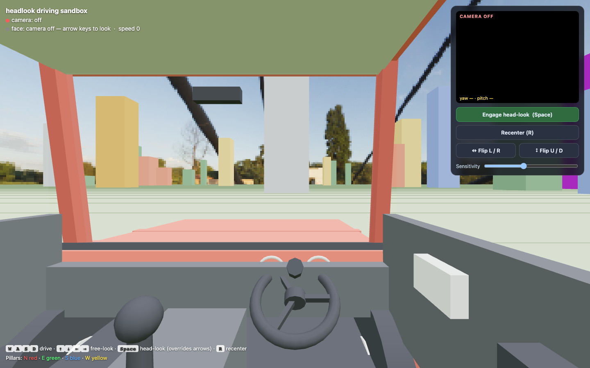
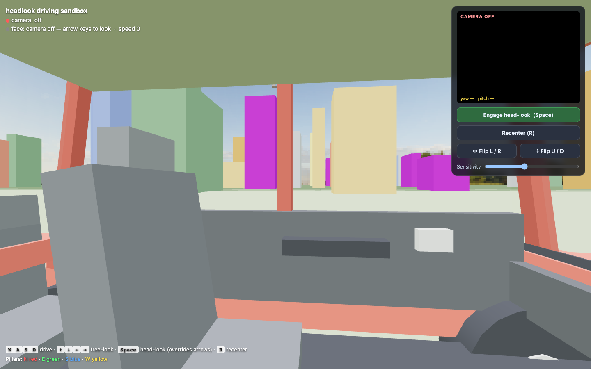

# headlook

<!-- HERO: GIF of looking into a corner in Art of Rally — Rishabh to add docs/images/hero.gif -->

Turn your head to look around in a driving game, while your hands stay on the wheel.

A proof of concept for macOS, 2026.

## How it works

Webcam → MediaPipe face landmarks → head yaw and pitch → the game camera, either over UDP to a small BepInEx plugin in Art of Rally, or straight into the browser sandbox.

## What it does

- **Tracks your head** (turn, tilt and lean) from an ordinary webcam, on the Mac.
- **Looks around in Art of Rally** through a small mod. Shift+L toggles it, Shift+K recenters. This is the one game I have verified it in.
- **Shows a see-through webcam preview** on top of the game, with the face mesh and live angles. It switches the camera off when the game quits.
- **Runs a driving sandbox in the browser**: a car with a right-hand-drive cockpit, pillars and big windows, so turning your head shows you something.
- **Is tunable**: dead zone, sensitivity, smoothing, invert and recenter.

## What's in the repo

```
headlook/            the Python app: tracker, mapping, outputs
  tracker.py           MediaPipe FaceLandmarker -> yaw / pitch / roll
  mapping.py           head angle -> look velocity or offset (dead zone, gamma)
  ratrack.py           Art of Rally tracker: UDP out + click-through preview overlay
  app.py               command-line app (preview / run / test-mouse modes)
  inject.py            synthetic mouse movement via Quartz   (experimental)
  fgfs.py              FlightGear view control               (experimental)
  config.py            all the tunables
sandbox/             the browser driving sandbox (sandbox.html + serve.py)
artofrally-mod/      the BepInEx plugin source (C#)
setup.sh             creates .venv, installs requirements, downloads the face model
run.sh               runs the Python app
play-artofrally.sh   starts Art of Rally and the tracker together
```

## Try it

### 1. The browser sandbox (nothing to install)

The webcam only works on `localhost` or https, so serve the folder instead of double-clicking the file. You need Python 3 (macOS gets one with Xcode's command line tools, or `brew install python`) and an internet connection (three.js and the face model load from CDNs).

```bash
python3 sandbox/serve.py
```

Open <http://localhost:8000/sandbox.html>, click **Enable camera & start** and allow the camera. If port 8000 is taken, use another: `PORT=8001 python3 sandbox/serve.py`.

Without a camera (or if you say no) it still runs: drive with WASD and look with the arrow keys.




| Key | Action |
|-----|--------|
| W A S D | drive |
| Space | engage / disengage head-look |
| R | recenter (sit straight first) |
| Arrow keys | free-look, if you have no camera |

If looking right pans the view left, use the **Flip L / R** or **Flip U / D** buttons in the panel.

### 2. Art of Rally (macOS)

You need your own copy of the game. It is not included. This is an **unofficial mod**: it is not made, approved or supported by the game's developers, it changes no game files except by adding BepInEx and one plugin next to them, and it may break after a game update. Use it at your own risk, in single player.

Built and tested with the Epic Games Store build of Art of Rally (Unity 2019.4, Mono) and BepInEx 5.4.23.

1. **Install BepInEx for macOS (Mono).** Download the macOS x64 build of BepInEx 5.4.x from the [BepInEx releases](https://github.com/BepInEx/BepInEx/releases) and unzip it into the game folder, next to the `Contents` folder. The Epic default is `/Users/Shared/Epic Games/artofrally`.
2. **Build the plugin.** Needs the [.NET SDK](https://dotnet.microsoft.com/download). Point it at your game folder if it is not the Epic default:
   ```bash
   cd artofrally-mod
   ART_OF_RALLY_DIR="/path/to/artofrally" dotnet build -c Release
   cp bin/Release/Headlook.ArtOfRally.dll "/path/to/artofrally/BepInEx/plugins/"
   ```
3. **Set up the tracker** (once): `./setup.sh`. It makes a `.venv`, installs the requirements and downloads the MediaPipe face model.
4. **Allow the camera** for Terminal in System Settings → Privacy & Security → Camera.
5. **Play.** From Terminal:
   ```bash
   ART_OF_RALLY_DIR="/path/to/artofrally" ./play-artofrally.sh
   ```
   (Leave the variable out if you use the Epic default.) It starts the game with BepInEx, waits about 12 seconds, then starts the tracker. (The tracker waits up to a minute for the game to appear. Ctrl-C stops it and turns the camera off.) A small webcam preview floats bottom-right. The tracker quits and the camera turns off about two seconds after you close the game.

In game, hold **Shift** and press **L** to toggle head-look and **K** to recenter. Keys, gain, limits and smoothing are in `BepInEx/config/com.headlook.artofrally.cfg` after the first run.

### 3. Experimental outputs

Both of these are written but **untested in a real game**. Set up with `./setup.sh` first.

- **Mouse-look** for games that read the mouse. Needs Camera, Accessibility and Input Monitoring permission for your terminal (the last one is for the F8 / F9 / F10 keys). Check that your game reacts first with `./run.sh --mode test-mouse`, then `./run.sh --mode preview` to tune, then `./run.sh --mode run`. F8 toggles, F9 recenters, F10 quits.
- **FlightGear** by setting the cockpit view over its telnet property server: `./launch-flightgear.sh`, then `./run.sh --mode run --output fgfs`.

## What isn't done

- **No virtual gamepad on macOS.** Looking with a right stick would be the cleanest input, but macOS gives normal apps no way to create one. A virtual HID driver needs an Apple-granted entitlement, and the system Game Controller framework ignores virtual devices. The one synthetic input macOS does allow is mouse movement, hence the experimental mouse-look. A small USB board posing as a real gamepad would work, but I haven't built it.
- Art of Rally is the only game it has been verified in.
- macOS only, and the mod has been tried on one Mac and one game version.

## Privacy

Nothing is recorded, saved or sent anywhere. In the sandbox the camera is read by your browser and frames never leave the page; it only downloads the three.js library and the face model. In the Python app and the Art of Rally tracker, frames are processed in memory and only head angles go out, over UDP to `127.0.0.1` on your own machine. The camera is released when you quit.

## Credits

See [NOTICE](NOTICE) for third-party pieces.

Shared to show the work. All rights reserved. Please ask before reusing any of it.
